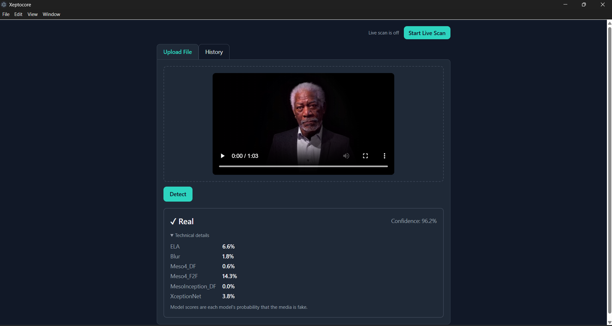
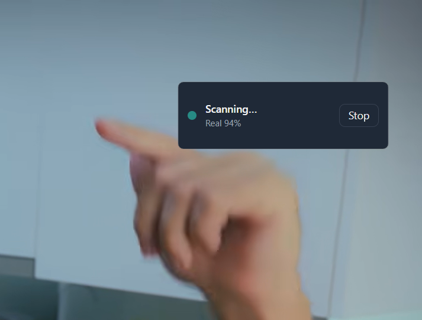
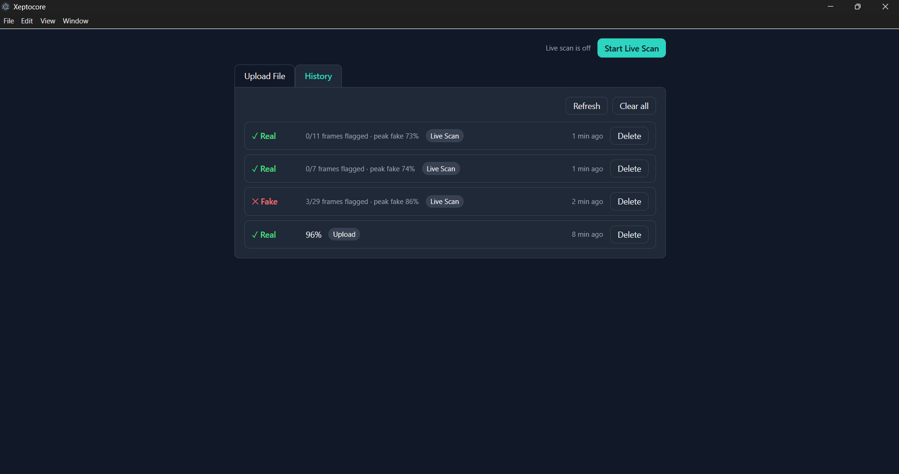
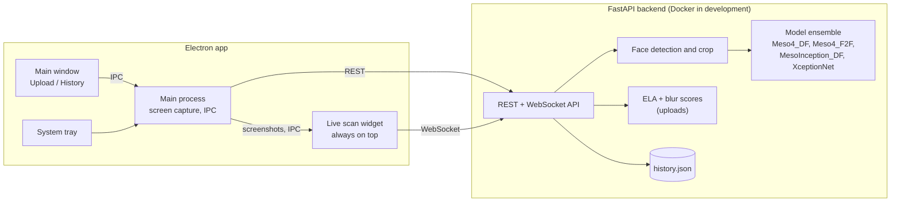

# Xeptocore

A desktop app that checks whether faces in images, videos, or **your live screen** look like deepfakes. Analysis runs on your own machine: nothing is uploaded to a cloud service.

Documentation: [docs/](docs/)

> **Status:** work in progress. Upload, live scan, and history all work in a development setup. A one-click installer is not available yet (see the [roadmap](#roadmap)).

<table border="0">
  <tr>
    <td align="center" width="33%">
      
      <br/>
      <sub><b>Upload & Result</b></sub>
    </td>
    <td align="center" width="33%">
      
      <br/>
      <sub><b>Live Scan Widget</b></sub>
    </td>
    <td align="center" width="33%">
      
      <br/>
      <sub><b>History</b></sub>
    </td>
  </tr>
</table>

## Features

- **Upload analysis**: drop in a JPEG, PNG, or MP4 and get a verdict (Real or Fake) with a confidence value. A collapsible "Technical details" section shows the ELA score, blur score, and each model's individual score.
- **Live scan**: watches your primary display and flags frames that look like a deepfake, for example during a video call. It runs in a small always-on-top widget and can be started from the main window or from the system tray.
- **History**: every upload is recorded, and each live scan session is saved as a single summary entry (frames scanned, frames flagged, highest fake score) so a long scan does not flood the list.
- **Private by design**: the backend runs locally, and the app has no accounts or cloud dependency.

## How it works



1. A face is detected and cropped from the image, video frame, or screen capture. Frames without a face are skipped.
2. Four models score the crop: three MesoNet variants and a fine-tuned XceptionNet. Their fake probabilities are combined in a weighted average (the heavier models count more).
3. The backend's `confidence` is that **fake probability**. A result is labelled _fake_ when it is above `0.44`; the UI then shows the probability of the winning label (for example "Real, 96%") so the number always matches the verdict.
4. For videos, the backend samples frames instead of analysing every one. For live scan, it analyses one screenshot per second and raises an alert when the fake probability is above `0.75`.

## Tech stack

| Part            | Technology                                                          |
| --------------- | ------------------------------------------------------------------- |
| Desktop shell   | Electron (main process, preload bridge, tray, always-on-top widget) |
| UI              | React, Vite, Tailwind CSS                                           |
| Backend         | Python, FastAPI, WebSocket                                          |
| Models          | TensorFlow / Keras (MesoNet variants, XceptionNet)                  |
| Packaging (dev) | Docker Compose for the backend                                      |

## Getting started

Developed and tested on Windows 10/11.

### Prerequisites

- [Docker Desktop](https://www.docker.com/products/docker-desktop/)
- [Node.js](https://nodejs.org/) (a current LTS release)
- Model weights in `backend/weights/` (they are large and git-ignored, so they are **not** in this repository):
  | File | Model |
  | --- | --- |
  | `Meso4_DF.h5` | Meso4 trained on Deepfake |
  | `Meso4_F2F.h5` | Meso4 trained on Face2Face |
  | `MesoInception_DF.h5` | MesoInception4 trained on Deepfake |
  | `xception_finetuned.h5` | Fine-tuned XceptionNet |
  The three MesoNet files come from the original [MesoNet](https://github.com/DariusAf/MesoNet) project.
  <!-- TODO: add a download link for xception_finetuned.h5 (e.g. GitHub Releases) -->
  If a weight file is missing, the backend still starts, but `/health` reports a degraded state and `/detect` returns an error.

### 1. Start the backend

```bash
git clone https://github.com/edgararya/Xeptocore.git
cd Xeptocore
docker compose up -d --build
```

Check that it is up:

```bash
curl http://localhost:8000/health
```

Detection history is stored in `backend/data/history.json` (mounted into the container, so it survives restarts).

### 2. Start the app

```powershell
cd frontend
npm install

# PowerShell
$env:XEPTOCORE_BACKEND_PORT = 8000; npm run dev
```

On macOS/Linux shells: `XEPTOCORE_BACKEND_PORT=8000 npm run dev`.

`XEPTOCORE_BACKEND_PORT` tells the app to use the backend that is already running instead of looking for a bundled executable (installers are planned, not available yet).

### Using it

- **Upload File** tab: drag a file in (or click to browse) and press **Detect**.
- **Live scan**: press **Start Live Scan** in the main window, or right-click the tray icon (check the hidden icons arrow in the taskbar) and choose **Start Live Scan**. A small widget appears at the top right of your screen.
- **History** tab: lists uploads and live scan sessions; use **Refresh**, **Delete**, or **Clear all**.

## Project structure

```text
.
├── backend/
│   ├── app/
│   │   ├── main.py          # REST + WebSocket endpoints
│   │   ├── detector.py      # model loading and ensemble inference
│   │   ├── classifiers.py   # MesoNet architectures
│   │   ├── face_utils.py    # face detection / cropping
│   │   ├── scoring.py       # ELA and blur scores
│   │   ├── history.py       # JSON-file history store
│   │   ├── live_session.py  # one history entry per live scan session
│   │   └── schemas.py       # response models
│   └── weights/             # model weights (git-ignored)
├── frontend/
│   └── src/
│       ├── main/            # Electron main process: window, tray, widget, IPC, preload
│       └── renderer/        # React UI: components, hooks, utils
└── docker-compose.yml
```

## API overview

| Method   | Path                                  | Purpose                                                  |
| -------- | ------------------------------------- | -------------------------------------------------------- |
| `GET`    | `/health`                             | Model status (`ok`, `degraded`, `error`)                 |
| `POST`   | `/detect`                             | Analyse an uploaded image or video                       |
| `WS`     | `/ws/live-scan?source=desktop_screen` | Stream screenshots, receive per-frame results and alerts |
| `GET`    | `/history`                            | List history entries                                     |
| `DELETE` | `/history/{id}`                       | Delete one entry                                         |
| `DELETE` | `/history`                            | Delete all entries                                       |

## Limitations and responsible use

- Results are **probabilities, not proof**. False positives and false negatives happen, so do not treat a single result as evidence against a person or a piece of content.
- The models look at faces. Content without a visible face, fully synthetic scenes, and audio are not analysed.
- The models were trained on specific face-manipulation methods and may generalise poorly to newer generators.
- Videos are sampled rather than analysed frame by frame.
- Live scan watches the primary display only, and screenshots are downscaled before analysis, so very small faces can be missed.
- Tested on Windows only.

## Roadmap

- [x] Upload analysis with technical details
- [x] Live scan widget and system tray
- [x] History with one summary entry per live scan session
- [ ] Windows installer (bundled backend, no Docker needed)
- [ ] Automated tests and CI
- [ ] Published evaluation results on a labelled test set
- [ ] Mobile support
- [ ] Auto-update

## Contributing

See [CONTRIBUTING.md](CONTRIBUTING.md). To report a security issue, see [SECURITY.md](SECURITY.md).

## Acknowledgements

- MesoNet: Afchar, Nozick, Yamagishi, Echizen. _MesoNet: a Compact Facial Video Forgery Detection Network_ (WIFS 2018).
- XceptionNet: Chollet. _Xception: Deep Learning with Depthwise Separable Convolutions_ (CVPR 2017).
  See [NOTICE](NOTICE) for third-party attributions.

## License

See [LICENSE](LICENSE).
