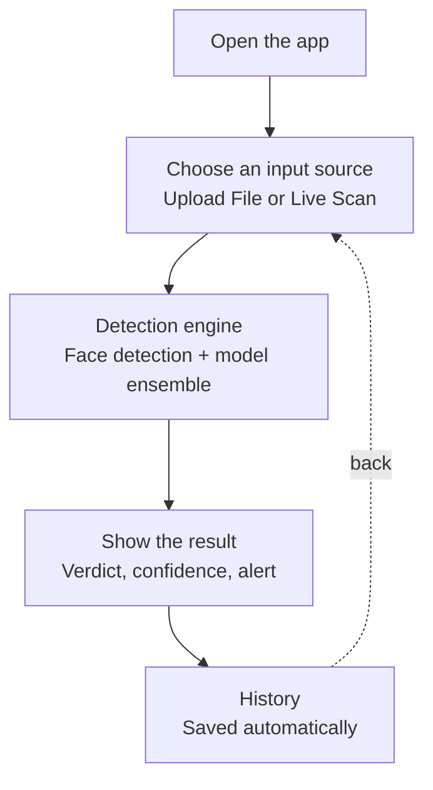
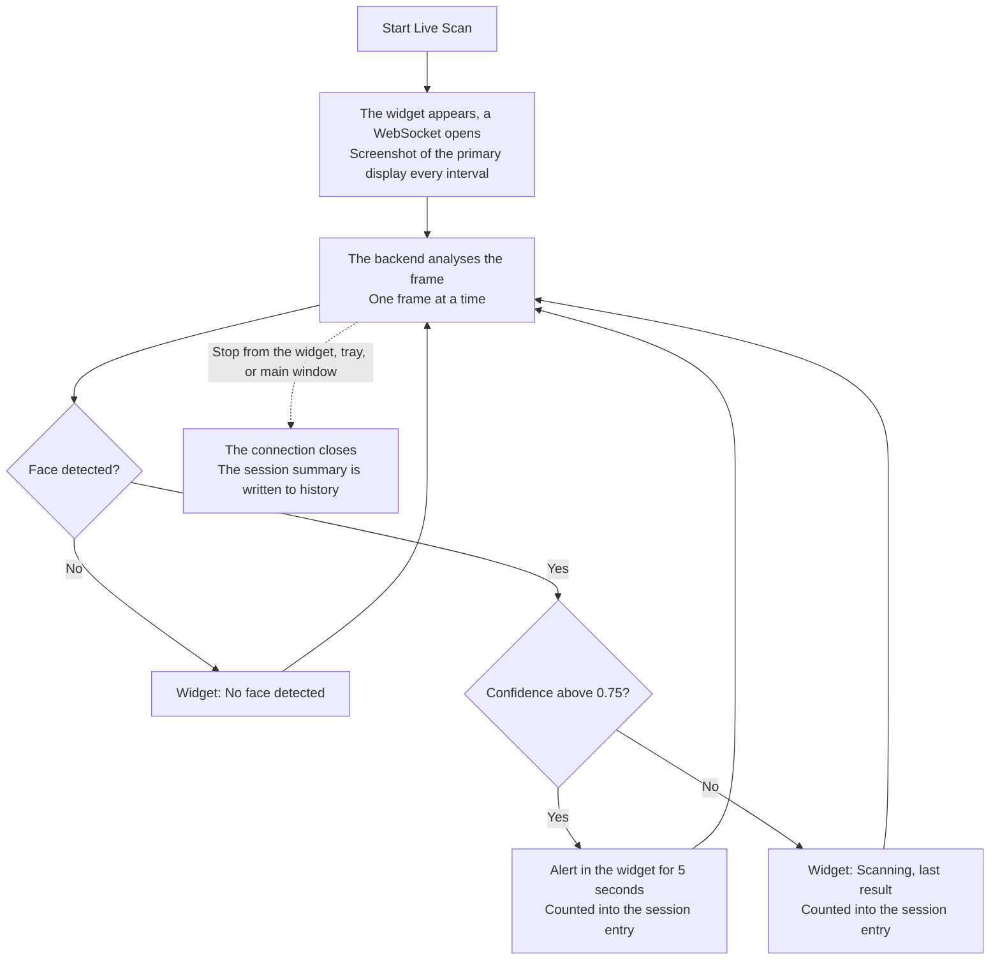

# Xeptocore: Flow Diagrams and User Flows

The user flows and the list of screens for Xeptocore. This document was first used as the reference for wireframes; it has since been synchronised with the running app, and each screen is marked as **implemented** or **not implemented** (see section 4). Technical details are in [`TECHNICAL_DESIGN.md`](TECHNICAL_DESIGN.md), and the design tokens are in [`design-system.md`](design-system.md).

---

## 1. Window structure

The app is made of three connected elements, not a single window:

| Element | Role |
|---|---|
| **Main window** | The main window: the "Upload File" and "History" tabs, plus a **Start/Stop Live Scan** button above the tabs. If it is closed while no scan is running, the app exits too. |
| **Live scan widget** | A small always-on-top window at the top right of the screen. It appears only while a scan is running, and stays visible while the user is in another app (for example, a video call). |
| **System tray** | A menu with Start/Stop Live Scan, Open Xeptocore, and Quit. If the main window is closed while a scan is still running, the app stays alive in the tray until the scan is stopped or the user chooses Quit. |

Live scan is **not** a tab in the main window. The main window and the widget are two separate designs: the widget is compact (an indicator, status text, and a Stop button), while the full detail lives in the main window. The label of the button in the main window and of the tray menu always follows the scan status, even if the scan was started or stopped from somewhere else.

---

## 2. Main user flow

**A. Open the app.** The main window appears. The backend must already be running (currently through Docker); there is no loading screen or `/health` check in the UI. If the backend is not ready, the failure only shows up when the first action runs, for example "Backend is not ready yet".

**B. Choose an input source.** Kept deliberately generic: adding a new source (for example a camera or a mobile device) only needs one more option at this point, without redrawing the flow. This matches the API's `source` parameter (`file_upload`, `desktop_screen`).

**C. Detection engine.** Uploaded files and live scan frames go through the same sequence conceptually: face detection, crop, then four models. ELA and blur are only computed for uploads.

**D. Show the result.** An upload shows a result card: the verdict (Real or Fake with an icon), the confidence, and a "Technical details" section that can be opened. Live scan shows its status in the widget.

**E. History.** An upload is saved as one entry per file. Live scan is saved as **one summary entry per session** (how many frames were analysed, how many raised an alert, and the highest fake score), not one entry per frame.

---

## 3. Sub-flow: Live Scan

**Starting.** From the Start Live Scan button in the main window or from the tray menu. The widget appears without taking focus from the app in use.

**Capture.** The main process takes a screenshot of the **primary display** (scaled down to a maximum width of 1280 px) every 1-second interval. The next frame is only sent after the result for the previous one has arrived, so no queue of stale frames builds up.

**Per-frame result.** A frame with no face is shown as "No face detected" and is not counted into the session. A frame with a face and a confidence above 0.75 raises an alert; the alert is held for 5 seconds after the last frame that raised it so it does not flash by unnoticed. The scan **does not stop** on an alert: the user has to press Stop (in the widget, the tray, or the main window).

**Widget statuses:** `Connecting`, `Scanning`, `Possible deepfake` (alert), and `Live scan error` (with a Close button).

### Alert severity levels

The original design distinguished several levels (a yellow badge for 50 to 70%, a red banner above 70%). **The current implementation has a single alert threshold (0.75).** Graduated levels remain an improvement idea, since the model produces false positives and an alert that is too loud can cause panic.

---

## 4. Screens and their status

| Screen / state | Status | Notes |
|---|---|---|
| Splash / loading while the backend loads | **Not implemented** | Needs a `/health` check in the UI |
| Error state: models failed to load | **Not implemented** | Today it only appears as an error message when an action runs |
| Upload File: empty | Implemented | A dropzone with a drag-and-drop hint |
| Upload File: file selected | Implemented | An image or video preview and a Detect button |
| Upload File: processing | Implemented | The button changes to "Detecting…" and is disabled |
| Upload File: result | Implemented | A result card with "Technical details" that can be opened |
| Upload File: error | Implemented | An error message with its code (for example, no face detected) |
| History: empty | Implemented | "No detection history yet." |
| History: list | Implemented | Newest first, at most 100 rows, Refresh, Delete, and Clear all with confirmation |
| History: detail of one entry | **Not implemented** | History only stores a summary, with no per-model detail |
| Live scan widget | Implemented | Connecting, scanning, alert, error |
| Widget "idle" | Not needed | The widget is hidden when no scan is running |
| Tray menu | Implemented | Start/Stop Live Scan, Open Xeptocore, Quit |
| Live Scan button in the main window | Implemented | With status text |

---

## 5. UX principles and how they are applied

- **Colour never stands alone.** A verdict is always paired with a text icon and a word (✓ Real, ✕ Fake, ? Unknown, ⚠ on an alert). The live scan status in the main window is text as well.
- **Neutral language, not alarm language.** The alert title in the widget is "Possible deepfake", not an exclamation.
- **Never block the screen during live scan.** There are no modals; the widget is small and does not take focus.
- **Progressive disclosure.** The ELA, blur, and per-model scores are hidden behind "Technical details".
- **Numbers that agree with the verdict.** Confidence is shown as the probability of the winning label ("Real, 96%"), not the raw fake probability.
- **An unknown label is never treated as safe.** A label other than `real` or `fake` is shown as "Unknown", not quietly turned into "Real".
