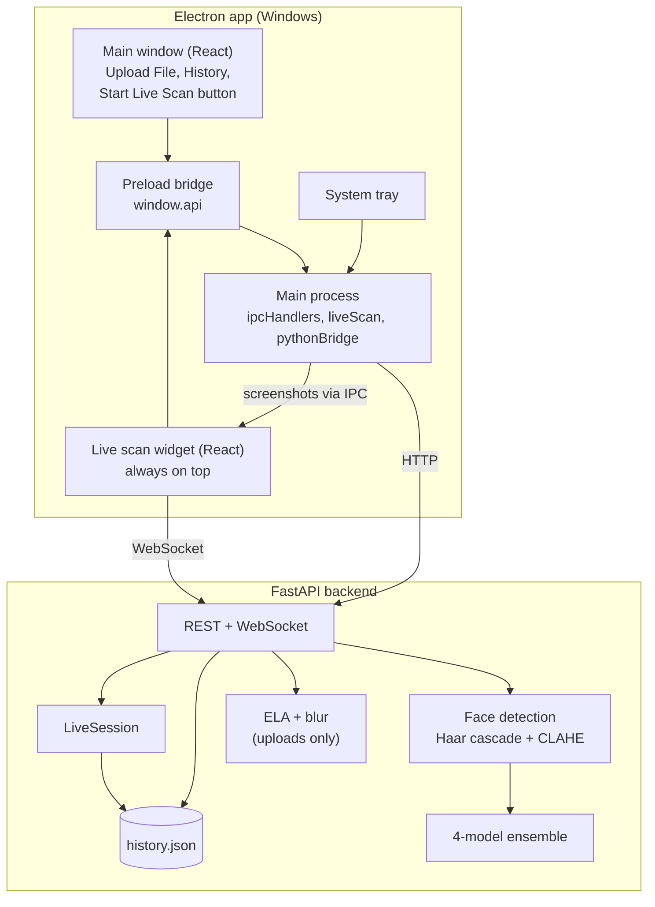
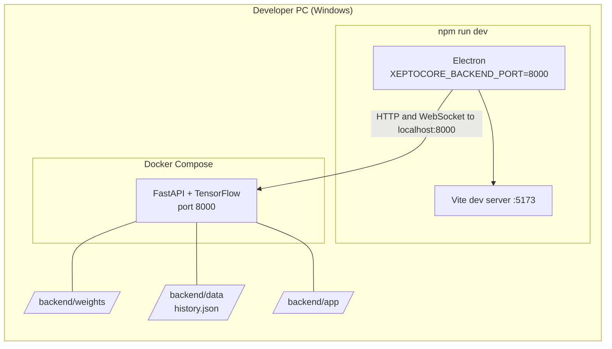
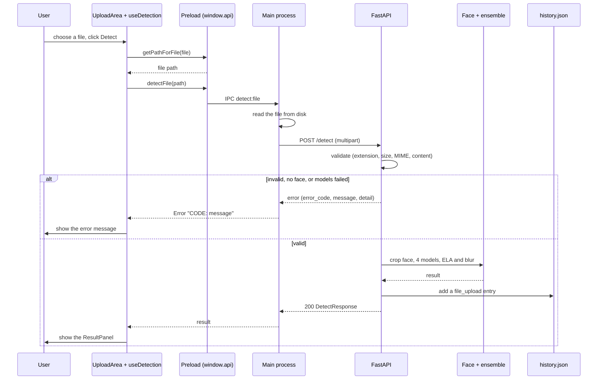
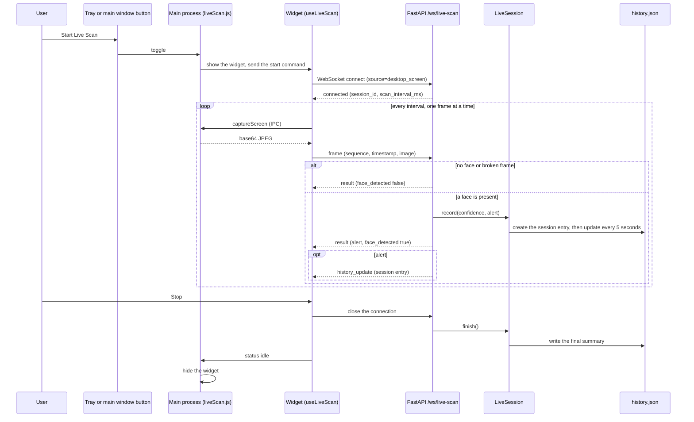
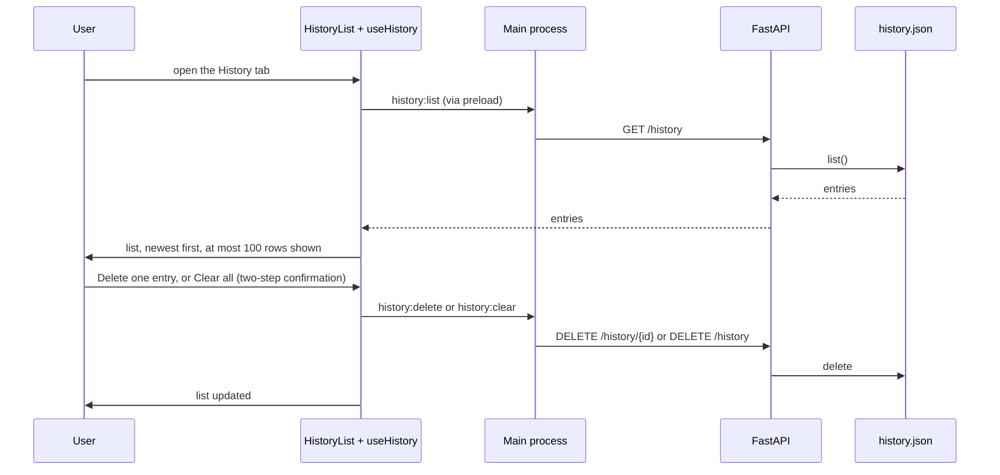
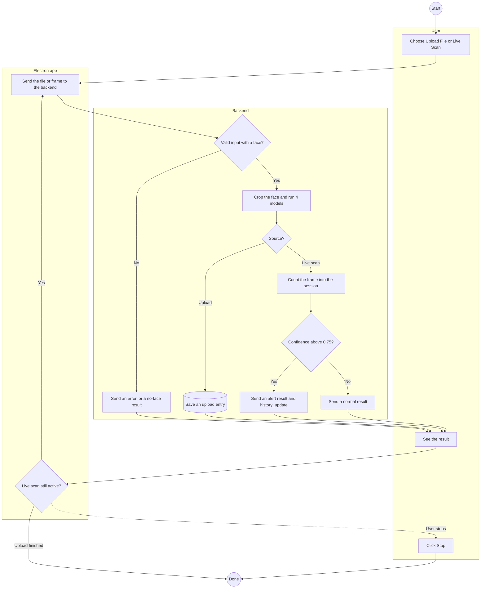

# Technical Design: Xeptocore

The technical design of the system **as implemented**: the big picture of how it works, without going down to class-level details that change often. This document was first written before coding started and has since been synchronised with the code; the section [Differences from the original plan](#9-differences-from-the-original-plan) records what changed and why. The detailed API contract is in [`API_CONTRACT.md`](API_CONTRACT.md).

---

## 1. Application diagram

Things to understand from this diagram:

- **The renderer never talks to the backend over HTTP.** The main window calls `window.api` (the preload bridge), which forwards the call over IPC to the main process, and the main process is the one that calls the backend (REST). The renderer does not import `electron` at all.
- **The exception: the live scan widget opens a WebSocket directly to the backend**, because the connection is long-lived and two-way. Its screenshots are still taken by the main process (`desktopCapturer`) and requested by the widget over IPC.
- **One detection engine for two input sources.** Uploaded files and live scan frames go through the same sequence: face detection, crop, four models. ELA and blur are only computed for uploads.
- The main window and the widget are two separate windows. The tray and the button in the main window both send commands to the main process, which forwards them to the widget.

## 2. Technology choices

| Need | Technology | Reason |
|---|---|---|
| Desktop shell | Electron | One web codebase for a desktop app; supports a tray, always-on-top windows, and screen capture |
| UI | React, Vite, Tailwind CSS | A familiar stack; Vite gives a fast dev server |
| Backend | Python, FastAPI | The detection models are already in Python/TensorFlow |
| Models | TensorFlow / Keras | MesoNet (three variants) and XceptionNet |
| History storage | JSON file | Local, single user, small data; see [section 4](#4-history-storage) |
| REST | HTTP | One-shot operations: file detection, history, health |
| Live scan | WebSocket | A connection that stays open for a stream of frames and results |
| Development | Docker Compose (backend) + `npm run dev` | Avoids installing TensorFlow by hand on the developer's machine |
| Packaging (planned) | PyInstaller + electron-builder (NSIS) | Not implemented yet |

## 3. Third-party integrations

None. All processing runs locally, with no cloud service, consistent with the goals in [`BRD.md`](BRD.md). Auto-update through GitHub Releases (`electron-updater`) is deferred to a later plan.

## 4. History storage

History is stored in one JSON file (`history.json`; the location can be changed with `HISTORY_FILE`). In Docker the file lives in the `./backend/data` volume, so it survives the container being recreated.

- Access is protected by a lock inside `HistoryStore`; saving is best-effort (a failed file write does not take the backend down).
- Every save **rewrites the whole file**. That is why live scan does not save every frame: one live scan connection summarises itself into a **single session entry** (the `LiveSession` class) that is updated at most every 5 seconds and written once more when the session ends.
- Only `id`, `source`, `label`, `confidence`, `timestamp`, and, for live scan sessions, `frames_scanned` and `alert_count` are stored. No images, frames, or per-model scores.
- The detailed entry shapes are in [`API_CONTRACT.md`](API_CONTRACT.md#history).

**Why not SQLite.** The original plan used SQLite with a `history` table and a `model_score` table (a one-to-many relation for per-model scores). For a single-user app with small data, a JSON file is enough, simpler, and needs no extra dependency. The consequences: there are no queries, and per-model scores are not kept in history. If history grows or per-entry detail is needed, migrating to SQLite is the natural next step.

## 5. Detection engine

1. **Face detection and crop** (`face_utils.py`): an OpenCV frontal Haar cascade on a CLAHE-enhanced image, taking the largest face and cropping it with a 35% margin. No face means no result.
2. **Four models** (`detector.py`), each producing a probability:

   | Key | Model | Input | Weight |
   |---|---|---|---|
   | `mesonet_1` | Meso4_DF | 256 px | 1 |
   | `mesonet_2` | Meso4_F2F | 256 px | 1 |
   | `mesonet_3` | MesoInception_DF | 256 px | 2 |
   | `xception` | XceptionNet (fine-tuned) | 299 px | 3 |

3. **Ensemble:** a weighted average. If a model is not loaded, the weights are recomputed from the models that are available and `/health` reports `degraded`. If none load, the status is `error`.
4. **Decision:** a `confidence` (fake probability) greater than `0.44` means `fake`.
5. **Extra scores for uploads** (`scoring.py`): ELA (re-save as JPEG at quality 90, amplify the difference, average the pixels) and a blur score (variance of the Laplacian against a reference of 200).
6. **Video:** every 10th frame is analysed, and the result is the average over the frames that contain a face.

## 6. Deployment

### Development (what runs today)

Three folders are mounted into the container: the code (`backend/app`), the model weights (`backend/weights`, not in git), and the history data (`backend/data`). Because the code is mounted, a backend change only needs `docker compose restart`.

### Target (not implemented yet)

A Windows installer without Docker: Electron starts the PyInstaller-built backend as a child process, reads the port from the `Backend ready on port ...` line, and stops it when the app closes (`pythonBridge.js` already prepares this side). The model weights are bundled. The Vite build path (`dist/renderer`) also still has to be aligned with the path `index.js` loads in a production build.

## 7. Sequence diagrams

### 7.1 Startup

The backend is assumed to be running already (Docker). Electron determines its port from `XEPTOCORE_BACKEND_PORT` (or, in a packaged build later, from the backend process it starts itself), then opens the window and the widget. There is no loading screen and no `/health` check in the UI today: if the backend is not ready, the failure only shows up when an action runs (for example, the message "Backend is not ready yet").

### 7.2 Upload a file

### 7.3 Live scan

On the widget side, an alert is held for 5 seconds after the last frame that raised it so it does not flash by unnoticed. The widget's status (`connecting`, `scanning`, `alert`, `error`) is reported to the main process, which broadcasts it to the main window, so the Start/Stop button label is always right even when the scan was started from the tray.

### 7.4 History

The History panel stays mounted while another tab is active, so the list is reloaded every time its tab is opened (and through the Refresh button).

## 8. Activity diagram

One flow serves both input sources; the difference is in how results are stored. An upload saves one entry per file. Live scan does not save per frame: every analysed frame is counted into a single session entry, and an alert only decides whether a `history_update` is sent as well.

## 9. Differences from the original plan

| Aspect | Original plan | Implementation | Notes |
|---|---|---|---|
| History storage | SQLite, `history` and `model_score` tables | A JSON file | See section 4 |
| Live scan history | One entry per frame (every result saved) | One entry per session with a summary | One entry per second floods the list and makes file writes heavier |
| Backend port | Found automatically (`find_free_port`) | Fixed from `PORT` (default 8000), plus `XEPTOCORE_BACKEND_PORT` on the Electron side for development | Port discovery has not been needed yet |
| Pre-processing | `preprocessing.py` | `face_utils.py` (face detection and crop) and `scoring.py` (ELA, blur) | Cropping the face turned out to be required before the models |
| Ensemble weights | Equal | 1, 1, 2, 3 | The reasoning behind the weights is not documented yet |
| Result schema name | `DetectionResult` | `DetectResponse` | |
| Error codes | Included `PROCESSING_TIMEOUT` | Removed (not implemented); "no face detected" uses `INVALID_FILE` | |
| Live scan in the UI | A tab in the main window | A separate widget, the tray, and a button in the main window | It has to stay visible while the user is in another app |
| Confidence shown in the UI | The raw fake probability | The probability of the winning label ("Real, 96%") | A small number next to "Real" reads as low confidence |
| Result for a frame with no face | Not designed | A neutral result with `face_detected: false` | So it does not look like a genuine "real" result |
| Running the backend | A PyInstaller executable | Docker in development; PyInstaller is still planned | |

## 10. Technical debt and known limitations

- **Inference blocks the event loop.** `run_inference` runs synchronously inside an `async` handler, so while one live scan frame is being processed, other requests (a history refresh, an upload) are held up too. The fix is to move inference to a thread pool.
- **The face detector is very permissive.** The Haar cascade is called with `minNeighbors=1`, so objects that are not faces can be detected as faces and receive a meaningless verdict. The frontal cascade is also weak on tilted, side-on, or very small faces. Replacing the detector or tightening its parameters is the change with the biggest impact on result quality.
- **No authentication and open CORS**, with port 8000 published in Docker. Fine for local development, not for a shared network.
- **The whole history file is rewritten on every save.** Live scan limits this by writing the session every 5 seconds; if the backend dies abruptly, up to 5 seconds of the latest session data can be lost.
- **Live scan captures the primary display only**, scaled down to a width of 1280 px, so very small faces can be missed.
- **There is no loading screen, `/health` check in the UI, or error view for models that failed to load**, as designed in [`FLOW_DIAGRAM.md`](FLOW_DIAGRAM.md).
- **There are no automated tests or CI**, and model accuracy has not been measured on a labelled test set.
- Only tested on Windows.

## 11. Cross-references

- API contract: [`API_CONTRACT.md`](API_CONTRACT.md)
- User flows and screens: [`FLOW_DIAGRAM.md`](FLOW_DIAGRAM.md)
- Design system: [`design-system.md`](design-system.md)
- Business background and requirements: [`BRD.md`](BRD.md)
